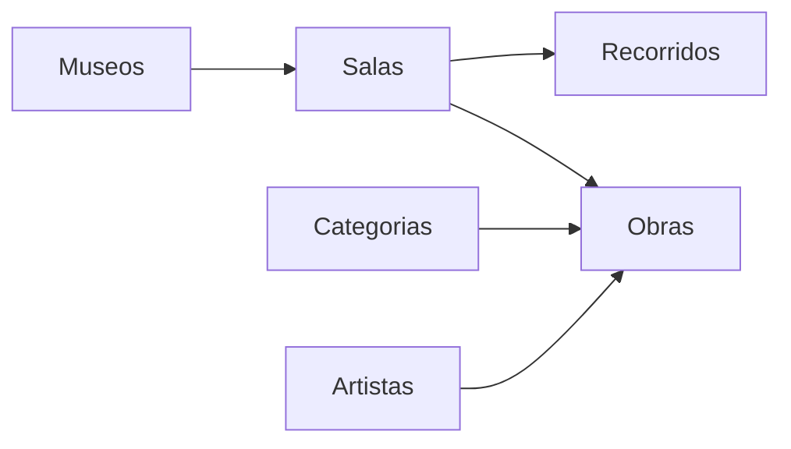
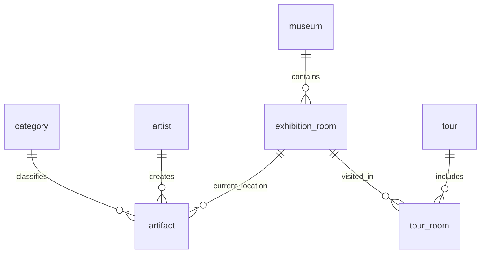

# Diseño estructural de requisitos

Sistema de Administración de Museos. Documento de análisis. No cambia el esquema ni implementa pantallas.

## 1. Fuentes

| Fuente | Qué aporta |
| --- | --- |
| `docs/museo.pdf`, página 1 | Alcance funcional: museos, obras, categorías, artistas, salas, historial de exposición y recorridos guiados. |
| `docs/museo.pdf`, página 2 | Modelo de datos vigente. Es la estructura que este diseño respeta. |
| Código del repositorio | App Flutter de plantilla (contador). Todavía no hay dominio ni persistencia. |

Cuando el texto del enunciado y el diagrama no dicen lo mismo, manda el diagrama. La diferencia queda registrada como brecha, no como tabla nueva.

## 2. Propósito

Centralizar el inventario de uno o varios museos: obras, quién las hizo, a qué categoría pertenecen, en qué sala están ahora y qué salas recorre cada visita guiada.

El sistema guarda referencias (URL de imagen y de páginas), no archivos. No hay usuarios, roles ni bitácora de cambios en el modelo actual.

## 3. Módulos

Cada módulo escribe solo en sus tablas. El orden de alta sigue las claves foráneas: primero museo, categoría y artista; después la sala; después la obra; al final el recorrido y su orden de salas.

| Módulo | Tablas | Responsabilidad |
| --- | --- | --- |
| Museos | `museum` | Nombre, descripción, coordenadas y página web. |
| Salas | `exhibition_room` | Salas de un museo: nombre, descripción y capacidad. |
| Categorías | `category` | Clasificación de obras. |
| Artistas | `artist` | Nombre, biografía y nacionalidad. |
| Obras | `artifact` | Ficha de la obra, estado de conservación y sala actual. |
| Recorridos | `tour`, `tour_room` | Visita guiada y el orden en que recorre las salas. |

No hay módulo de historial. El enunciado lo pide; el modelo no lo tiene. Ver sección 7.

## 4. Diccionario del modelo vigente

Tipos tal como aparecen en el diagrama: `int`, `string`, `float`, `timestamp`. No hay longitudes, checks ni nulabilidad explícita en atributos que no son clave. La obligación de cada foránea se lee de la cardinalidad.

### `museum`

| Columna | Tipo | Rol |
| --- | --- | --- |
| `id` | int | PK |
| `name` | string | Nombre del museo |
| `description` | string | Descripción |
| `latitude` | float | Latitud |
| `longitude` | float | Longitud |
| `landing_page_url` | string | Página web |

### `exhibition_room`

| Columna | Tipo | Rol |
| --- | --- | --- |
| `id` | int | PK |
| `museum_id` | int | FK a `museum`. Obligatoria: toda sala pertenece a un museo. |
| `name` | string | Nombre de la sala |
| `description` | string | Descripción |
| `capacity` | int | Capacidad |

### `category`

| Columna | Tipo | Rol |
| --- | --- | --- |
| `id` | int | PK |
| `name` | string | Nombre |
| `description` | string | Descripción |

### `artist`

| Columna | Tipo | Rol |
| --- | --- | --- |
| `id` | int | PK |
| `name` | string | Nombre |
| `biography` | string | Biografía |
| `nationality` | string | Nacionalidad |

### `artifact`

| Columna | Tipo | Rol |
| --- | --- | --- |
| `id` | int | PK |
| `name` | string | Nombre de la obra |
| `description` | string | Descripción |
| `image_url` | string | URL de la imagen. No es un archivo local. |
| `created_at` | timestamp | Fecha de creación de la obra, no del registro. |
| `acquired_at` | timestamp | Fecha de adquisición. |
| `condition_percentage` | int | Porcentaje de conservación. |
| `category_id` | int | FK a `category`. Obligatoria. |
| `artist_id` | int | FK a `artist`. Obligatoria en el diagrama. |
| `exhibition_room_id` | int | FK a `exhibition_room`. Sala actual (`current_location`). Obligatoria en el diagrama. |

### `tour`

| Columna | Tipo | Rol |
| --- | --- | --- |
| `id` | int | PK |
| `name` | string | Nombre del recorrido |
| `description` | string | Descripción |
| `start_at` | timestamp | Inicio |
| `end_at` | timestamp | Fin |
| `landing_page_url` | string | Página del recorrido |

Un recorrido no tiene `museum_id`. Puede incluir salas de más de un museo.

### `tour_room`

| Columna | Tipo | Rol |
| --- | --- | --- |
| `tour_id` | int | FK a `tour`. Obligatoria. |
| `exhibition_room_id` | int | FK a `exhibition_room`. Obligatoria. |
| `sequence_number` | int | Orden de la sala dentro del recorrido. |

El diagrama no marca una PK sustituta. Interpretación de este diseño, sin alterar el esquema: la fila se identifica por el par (`tour_id`, `exhibition_room_id`). Con esa clave, una sala entra una sola vez en cada recorrido.

## 5. Relaciones

| Relación en el diagrama | Lectura | Dónde vive |
| --- | --- | --- |
| `contains` | Un museo tiene cero o muchas salas. Cada sala tiene un museo. | `exhibition_room.museum_id` |
| `classifies` | Una categoría agrupa cero o muchas obras. Cada obra tiene una categoría. | `artifact.category_id` |
| `creates` | Un artista tiene cero o muchas obras. Cada obra tiene un artista. | `artifact.artist_id` |
| `current_location` | Una sala es la ubicación actual de cero o muchas obras. Cada obra tiene una sala actual. | `artifact.exhibition_room_id` |
| `visited_in` | Una sala aparece en cero o muchas paradas. Cada parada apunta a una sala. | `tour_room.exhibition_room_id` |
| `includes` | Un recorrido tiene cero o muchas paradas. Cada parada pertenece a un recorrido. | `tour_room.tour_id` |
| `exhibited_in` | Línea dibujada entre `artifact` y `exhibition_room`: una obra hacia muchas salas. | No tiene tabla ni columnas. |

`current_location` y `exhibited_in` unen a las mismas dos entidades. Solo la primera está materializada.

## 6. Requisitos mapeados al modelo

Los verbos de gestión del enunciado se leen como alta, consulta, edición y baja del registro. El PDF no detalla pantallas, permisos ni reglas de borrado.

### Museos — `museum`

Registrar nombre, descripción, ubicación geográfica y URL.

- La ubicación son `latitude` y `longitude`. No hay dirección, ciudad ni país.
- La URL es `landing_page_url`.

### Salas — `exhibition_room`

Registrar nombre, descripción y capacidad, siempre dentro de un museo.

- No se puede crear una sala sin `museum_id`.
- `capacity` es un entero. El diagrama no define mínimo ni máximo.

### Categorías — `category`

Clasificar obras para organizarlas y localizarlas.

- Una obra tiene una sola categoría.
- El modelo no trae jerarquía ni subcategorías.

### Artistas — `artist`

Mantener nombre, biografía y nacionalidad.

- En el diagrama cada obra tiene exactamente un artista (`artist_id` obligatoria).
- El enunciado dice “como máximo un artista”, lo que permitiría obras sin autor. Este diseño sigue el diagrama. La diferencia queda en la sección 7.

### Obras — `artifact`

Registrar descripción, imagen, fecha de creación, fecha de adquisición, porcentaje de conservación, categoría, artista y sala actual.

- `created_at` y `acquired_at` son datos de la pieza, no marcas de auditoría.
- `image_url` apunta a un recurso externo.
- `condition_percentage` es `int`. La regla de rango 0 a 100 no está en el diagrama; si se aplica, es validación de la aplicación.
- La sala actual es `exhibition_room_id`. Cambiar de sala, con este modelo, sustituye ese valor. No deja rastro de la sala anterior.

### Recorridos — `tour` y `tour_room`

Crear visitas con descripción, inicio, fin y URL. Cada visita incluye varias salas en un orden concreto.

- La cabecera está en `tour` (`name`, `description`, `start_at`, `end_at`, `landing_page_url`).
- Las salas y el orden están en `tour_room.sequence_number`.
- El diagrama no declara único `sequence_number` dentro del mismo `tour_id`. Para que el orden sea un recorrido y no una lista con empates, la aplicación no debería repetir el número de secuencia en un mismo recorrido.
- Un recorrido puede quedar sin salas: la cardinalidad es cero a muchas.
- Nada impide mezclar salas de museos distintos en un mismo recorrido.

### Historial de exposición — no cubierto

El enunciado pide las salas por las que pasó cada obra, con fecha de inicio y de fin. El modelo solo guarda la sala actual. La relación dibujada `exhibited_in` no agrega columnas. Con el esquema actual no se puede consultar un periodo de exposición cerrado.

## 7. Brechas

Estas diferencias no se resuelven en este documento. Quedan para una decisión posterior. Mientras tanto el diseño no agrega tablas ni columnas.

| Tema | Enunciado | Modelo actual |
| --- | --- | --- |
| Historial de salas | Periodos con inicio y fin. | Solo `artifact.exhibition_room_id`. `exhibited_in` no es una tabla. |
| Artista de la obra | Como máximo uno. Puede no tener. | `artist_id` obligatoria: exactamente uno. |
| Porcentaje de conservación | Porcentaje. | `int`, sin rango declarado. |
| Usuarios y permisos | No los menciona. | No existen. |
| Borrado | No lo define. | No hay `ON DELETE` en el diagrama. |

Consecuencia práctica del historial: mover una obra de sala actualiza `exhibition_room_id` y se pierde la sala previa. Un recorrido (`tour_room`) tampoco sirve de historial: registra el orden de una visita, no el tiempo que una obra estuvo expuesta.

## 8. Reglas que sí caben en el modelo

1. Toda sala pertenece a un museo.
2. Toda obra tiene una categoría, un artista y una sala actual.
3. Un artista, una categoría, un museo o una sala pueden existir sin obras asociadas.
4. La imagen de la obra y las páginas web se guardan como URL.
5. El orden de un recorrido es `tour_room.sequence_number`.
6. Una misma sala no se repite dentro de un recorrido, si la fila se identifica por (`tour_id`, `exhibition_room_id`).
7. Consultar “qué hay en esta sala” es filtrar `artifact` por `exhibition_room_id`.
8. Consultar “qué recorre esta visita” es leer `tour_room` de ese `tour_id` ordenado por `sequence_number`, y de ahí la sala y su museo.

## 9. Fuera de este diseño

- Cambiar o migrar el esquema.
- Pantallas, navegación y código Flutter.
- Autenticación, roles y auditoría.
- Almacenar imágenes en el dispositivo o en un servidor propio.
- Una tabla de historial de exposición. Hace falta acuerdo explícito antes de añadirla, porque el modelo entregado no la trae.

## 10. Trazabilidad

| Requisito del PDF | Soporte en el modelo |
| --- | --- |
| Museos: nombre, descripción, coordenadas, URL | `museum` |
| Salas: nombre, descripción, capacidad, dentro de un museo | `exhibition_room` |
| Categorías de obras | `category` y `artifact.category_id` |
| Artistas: nombre, biografía, nacionalidad; una obra, un artista | `artist` y `artifact.artist_id` |
| Obras: descripción, imagen, creación, adquisición, conservación, categoría, artista, sala actual | `artifact` |
| Historial de exposición con inicio y fin | Sin soporte |
| Recorridos: descripción, inicio, fin, URL, varias salas en orden | `tour` y `tour_room` |
